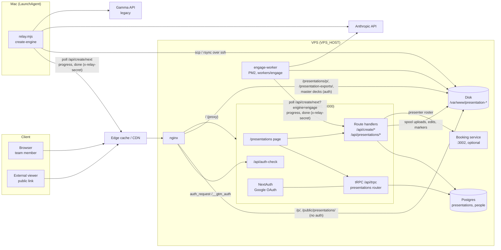

# Architecture

GTM Workspace is one Next.js app on one VPS. The Presentations module is a page plus a set of API
routes inside that app. Everything heavy (AI generation, headless Chrome capture, PowerPoint and PDF
assembly) runs outside the request path in two background consumers that poll the app for work:

- the **engage worker** on the VPS (prospect sales decks), and
- the **local relay** on a Mac (decks created from an uploaded file, text or voice memo).

Finished decks are plain folders on disk that nginx serves directly. The app never streams deck
files itself; it owns the metadata (one Postgres table) and the access rules.



## App shell and authentication

- **Sign-in.** NextAuth v5 with the Google provider (`src/lib/auth.ts`). The `signIn` callback
  admits only the company's email domains plus a static external-partner allowlist
  (`src/lib/externalPartners.ts`). The allowlist is a plain `Set`, not a database lookup, because the
  callback is also bundled into the edge middleware where the Postgres driver cannot run. The
  `session` callback copies the token subject to `session.user.id` and applies display-name overrides.
- **Proxy (middleware).** `src/proxy.ts` (Next 16's name for middleware) redirects any page request
  without a session to `/login`, and a signed-in visitor on `/login` to `/presentations`. Its matcher
  skips `/api/auth`, `/api/create` (large multipart uploads are not truncated by the proxy body cap,
  and the relay endpoints authenticate with a header; every one of those routes enforces its own
  auth) and static files. `/pp-edit.js` is explicitly public because public decks and the headless
  exporter load it, and `/api/trpc` passes through because `protectedProcedure` guards itself.
- **Role resolution.** `getEffectiveRole(email)` (`src/server/trpc/routers/admin.ts`) expands the
  address to every company-domain variant (`emailVariants` in `src/lib/identity.ts`, since each person
  has an address on two domains) and returns the highest role found. In this export the roles are
  `super_admin` (from `SUPER_ADMIN_EMAILS`), `external_partner` (clamped from the allowlist) and `user`.
  The full app also reads a `user_roles` table and per-module access grants; those were trimmed.
- **"View as".** A super admin can preview the app as someone else. The client sends an
  `x-pp-view-as` header; the tRPC context swaps `userEmail` for that address, and `protectedProcedure`
  rejects every mutation while impersonating, so a preview can never change data. The Saved-slides
  route honours the same header for reads.

## tRPC and route handlers

The module splits its server surface by the kind of work:

| Surface | Used for | Auth |
|---|---|---|
| tRPC `presentations.*` (`src/server/trpc/routers/presentations.ts`) | Lists, get, create, rename, archive, sharing, public flag, delete, people pick-list | Session (`protectedProcedure`) |
| `POST /api/create`, `/api/create/engage`, `/api/create/scout`, `/api/create/edit` | Multipart uploads, spool writes, spawning the site scout | Session, checked in the handler |
| `GET /api/create/next`, `POST /api/create/progress`, `POST /api/create/done` | The job feed and status callbacks for the relay and the worker | `x-relay-secret` header equal to `RELAY_SECRET` |
| `/api/presentations/{edits,hidden,image,add-slide,save-slide,saved-slides}` | Slide Editor: patch layer, hidden slides, photo uploads, add-a-slide requests, Saved slides | Session plus owner / super-admin checks |
| `GET /api/auth-check` (`src/app/api/auth-check/route.ts`) | nginx `auth_request` target: `204` with a valid session cookie, `401` otherwise | Session cookie |

Route handlers are used wherever the work is file-shaped (multipart bodies, writing into
`/var/www/...`, spawning a child process); tRPC is used for everything that is pure database.
All route handlers set `export const dynamic = "force-dynamic"`.

## Database

Drizzle ORM over `pg` (`src/server/db/index.ts`). The pool is created lazily on the first query, so
`next build` never connects. Production Postgres runs on the same VPS (`localhost:5432`, no TLS); a
URL that asks for `sslmode=require` still works for a managed database.

Two tables matter to this module:

- `presentations`: one row per user-created deck (master decks have no row). Full field list in
  `docs/ENGINE.md`.
- `people`: the team directory. Used for owner names on cards, the share pick-list and the sales-deck
  presenter roster.

Every list query is wrapped in `try / catch` and returns `[]` on failure, so the page still renders
the master decks if the database is unreachable or a migration has not run.

## Workers

| Consumer | Runs on | Picks up | Talks to the app via |
|---|---|---|---|
| `engage-worker` (`workers/engage/engage-worker.mjs`) | VPS, PM2, from `<WORKERS_DIR>/engage/` | `engine = "engage"` rows, Slide Editor add-slide requests, re-export markers, Saved-slide thumbnails | `http://127.0.0.1:3000` (`ENGAGE_APP`), so it never leaves the box |
| Local relay (`engine/create-engine/relay.mjs`) | A Mac, LaunchAgent | Every other engine (`claude`, legacy `gamma`), including live-builder edit jobs | `https://<APP_DOMAIN>` for the job API; ssh to the VPS for files |

Both poll `GET /api/create/next` (worker every 4 s, relay every 5 s). The route picks the oldest
`editing` row first, then the oldest `generating` row, and flips it to `processing` with an update
conditioned on the old status. The `?engine=engage` parameter keeps the two job streams apart, so the
relay and the worker never compete for a row. The route does not check the update's row count, so two
consumers of the same stream could both receive a job; run exactly one relay and one worker.

The worker's headless Chrome resolves `<APP_DOMAIN>` to `127.0.0.1` (`--host-resolver-rules`), so
export captures hit the local nginx directly instead of going out through the CDN.

The presenter roster also calls a separate booking service on `127.0.0.1:3002` for personal booking
links; if it is down, presenters simply have no booking link.

## nginx in front

nginx terminates TLS and routes by path. Static locations sit above the catch-all proxy, so their
longer prefixes win.

| Location | Serves | Auth |
|---|---|---|
| `/` | `proxy_pass` to the app on `127.0.0.1:3000` | App handles it |
| `= /__gtm_auth` (internal) | `proxy_pass` to the app's `/api/auth-check`, body stripped | n/a |
| `/presentations/p/<slug>[/<page>]` | `try_files /_viewer.html` from `/var/www/presentation-public` (fullscreen viewer) | `auth_request /__gtm_auth` |
| `/public/presentations/<slug>[/<page>]` | the same `_viewer.html`, public mode | none |
| `/p/` | `/var/www/presentation-public`: deck folders, public PPTX/PDF copies, thumbnails, template and library images, the engage template's `_next` assets | none |
| `/presentation-exports/` | `/var/www/presentation-exports`: authed downloads | `auth_request` |
| `/presentations/<master-deck>/` | `/var/www/presentation-decks/<deck>/` (static exports of the hand-built master decks), one block per deck | `auth_request` |
| `/presentation-agent/` | `/var/www/presentation-agent/` (older static intake and template viewer) | `auth_request` |

A `401` from the auth subrequest is turned into a redirect to `/login`. Because every gated static
surface asks the app, there is one session and one sign-in for the app and all decks.

Sketch of the shape (sanitized, not the production file):

```nginx
location = /__gtm_auth {
    internal;
    proxy_pass http://127.0.0.1:3000/api/auth-check;
    proxy_pass_request_body off;
    proxy_set_header Content-Length "";
    proxy_set_header Cookie $http_cookie;
}
location /presentation-exports/ {
    auth_request /__gtm_auth;
    error_page 401 = @login;
    alias /var/www/presentation-exports/;
}
location /p/ {
    alias /var/www/presentation-public/;
}
location @login { return 302 /login; }
```

## VPS layout

```
/var/www/
  <APP_DIR>/                    Next standalone build: server.js, .next/, public/, .env (never shipped)
  acme-gtm-workers/             <WORKERS_DIR>: .env, node_modules (puppeteer, sharp, pptxgenjs, pdf-lib, SDK)
    engage/                     engage worker scripts + engage-library.json
  presentation-public/          every published deck, public downloads, shared assets (see ENGINE.md)
  presentation-exports/         authed PPTX / PDF downloads, one folder per slug
  presentation-decks/           static exports of the hand-built master decks
  presentation-spool/           job inbox: uploads, voice memos, edit / slide / re-export requests, _saved markers
  presentation-templates/       template gallery material (not written by code in this repo)
  presentation-backups/         manual snapshots (not written by code in this repo)
  presentation-agent/           older static presentation tool (intake, template viewer)
<ENV_BACKUP>                    server-side copy of the app's .env, restored by deploy if .env goes missing
/etc/nginx/                     site config + a locations snippet included by the :80 and :443 server blocks
```

PM2 processes relevant here: the app (`server.js`, port 3000, started with `--env-file <APP_DIR>/.env`)
and `engage-worker`. Other unrelated workers share the box.

## The local Mac relay

The Create-from-file pipeline needs tooling that is awkward on a small Linux VPS: an arm64 Python
with PyMuPDF, python-pptx and python-docx, local Whisper for audio (Apple Silicon build first),
LibreOffice, `sips`, and a Playwright-based exporter. So it runs on a Mac:

- **Bundle.** `sync-bundle.sh` copies the relay, generator, ingest script, exporter scripts and their
  `node_modules`, brand fonts and brand assets into a self-contained folder under
  `~/Library/Application Support/`. launchd jobs are restricted by macOS privacy controls from reading
  `~/Documents`, so the bundle lives outside it. Re-run the script after editing any engine source,
  then restart the agent with `launchctl kickstart -k gui/$(id -u)/<LAUNCHD_LABEL>`.
- **LaunchAgent.** A user LaunchAgent with `KeepAlive`, `RunAtLoad` and `ThrottleInterval 30` runs a
  `start.sh` (same shape as `run-relay.sh`: load `relay.env`, extend `PATH`, `exec node relay.mjs`),
  logging to `relay.log` in the bundle folder.
- **Network.** The relay calls the app's public URL with `x-relay-secret` and moves files with
  `scp` / `rsync` over ssh (`VPS_SSH`), so the Mac needs an ssh key authorised on the VPS. Nothing
  listens on the Mac.
- **Failure mode.** If the Mac is asleep or offline, uploaded decks stay `generating` until it comes
  back; the engage stream is unaffected because it runs on the VPS.
