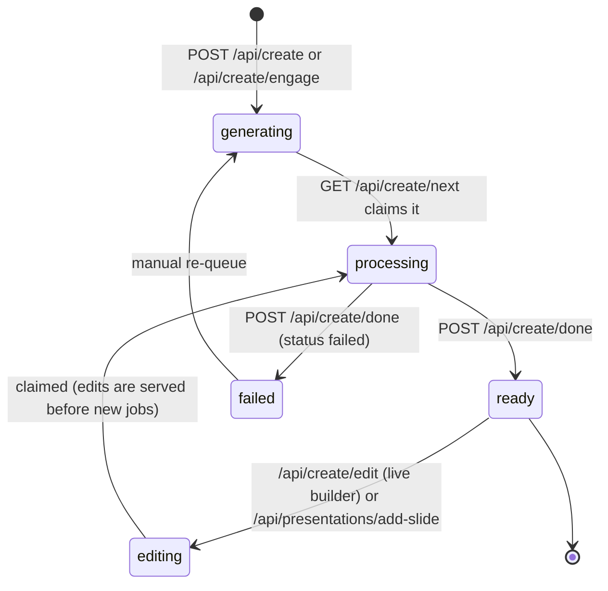
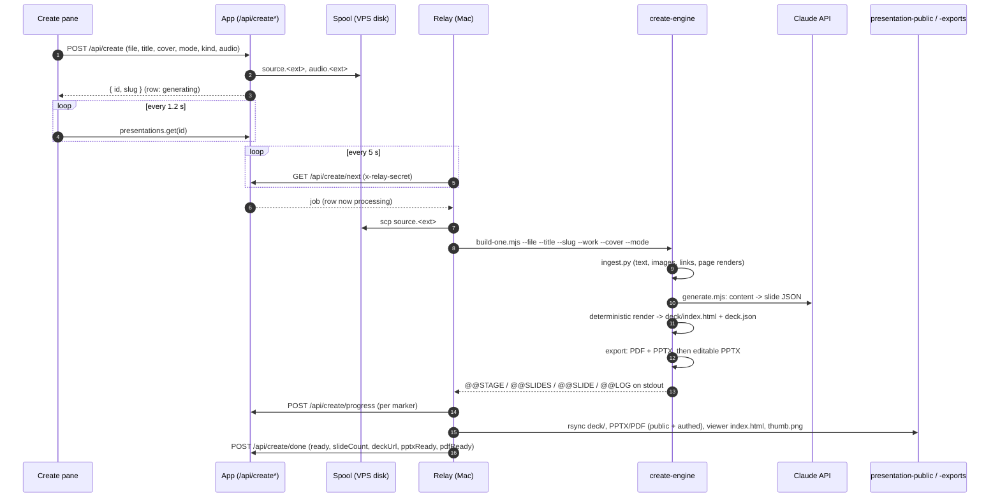
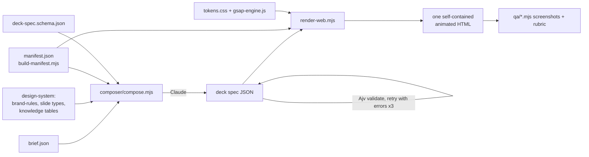
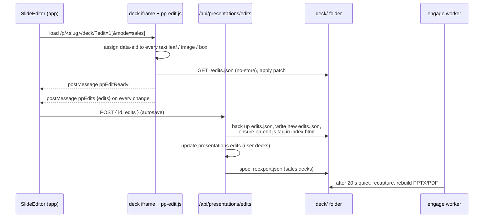

# The presentation engine

How a deck is created, rendered, edited, exported and shared, end to end.

## 1. Three kinds of deck, one serving model

| Kind | Produced by | DB row | Lives in |
|---|---|---|---|
| **Master decks** (`acme-introduction-deck`, `acme-sales-deck`, `acme-short-pack`, `acme-proposal-deck`, ...) | Hand-built React in `engine/web-deck`, exported static | none (listed in code in `page.tsx`) | `/var/www/presentation-decks/<deck>/` and/or `/var/www/presentation-public/<deck>/` |
| **Created decks** (`engine = "claude"`, legacy `"gamma"`) | Local relay + `engine/create-engine` from an uploaded file, pasted text or a voice memo | `presentations` | `/var/www/presentation-public/<slug>/` |
| **Sales decks** (`engine = "engage"`, `kind = "sales"`) | VPS engage worker from a prospect's website, on the shared engage template | `presentations` | `/var/www/presentation-public/<slug>/` |

Every generated deck ends up with the same folder shape, so the module, the viewer, the editor and
nginx treat them alike:

```
/var/www/presentation-public/<slug>/
  index.html            viewer wrapper (iframes deck/, top-right Edit / PPTX / PDF / Share / Full screen)
  deck/                 the deck itself (index.html + assets, plus deck.json or spec.json, edits.json)
  <slug>.pptx|pdf       public downloads (+ <slug>--<key>.pptx|pdf signature variants for sales decks)
  thumb.png             card thumbnail
/var/www/presentation-exports/<slug>/<slug>[--<key>].pptx|pdf     authed downloads
```

The design rule behind every generator: **the model never writes the page.** Claude returns
structured JSON (a slide array or a deck spec) and a deterministic renderer turns it into HTML, so a
bad generation produces a plain slide, not a broken one. The one exception (bespoke "novel" slides,
opt-in) is sanitized and capped.

`engine/engine-v2` is the formal, schema-validated version of that rule (section 7). In this codebase
it runs standalone from the CLI; the live Create path uses `create-engine/generate.mjs`, and sales decks
use the engage template.

## 2. Data model

### `presentations` (`src/server/db/schema/presentations.ts`)

One row per created or sales deck. Master decks have no row.

| Column | Type | Meaning |
|---|---|---|
| `id` | text PK | UUID, also the spool folder name |
| `title` | text | Card title |
| `owner_email` | text | Creator; drives ownership checks |
| `slug` | text | Deck folder and public id. Created decks: `u-<8 hex>`. Sales decks: `acme-<client>-sales-deck[-n]`, unique against the DB and the disk |
| `status` | text | `generating` (queued) / `processing` (claimed) / `editing` (edit queued) / `ready` / `failed` |
| `status_msg` | text | Short progress or error text for the card |
| `source_file` | text | Original upload name (sales decks: the prospect URL) |
| `cover_style` | text | `device` / `master` / `gradient` / `light` / `dark` (generator also knows `hybrid`) |
| `build_mode` | text | `full` (reconstruct diagrams, redesign) or `quick` (simple templates, keep wording) |
| `kind` | text | `general` (My Decks) or `sales` (Sales Decks) |
| `engine` | text | `claude` / `gamma` / `engage`: which pipeline builds it and which consumer gets the job |
| `gamma_url` | text | Hosted Gamma deck (legacy engine) |
| `source_audio` | text | Spooled voice-memo filename kept with the deck |
| `slide_count` | text | Reported on completion |
| `deck_url` | text | `/p/<slug>/` |
| `public_enabled` | bool | Public-link flag set from the share dialog (see section 10) |
| `company_shared` | bool | Shared with everyone signed in |
| `company_role` | text | `view` / `edit` for the company share |
| `shared_emails` | jsonb | `[{ email, role: "view" \| "edit" }]` |
| `pptx_ready`, `pdf_ready` | bool | Export availability |
| `canva_url` | text | Canva design link if one was imported |
| `archived` | bool | Soft delete; hidden from every list, recoverable |
| `progress` | jsonb | `{ stage, slidesTotal, slidesDone, log[] }`, log capped at the last 50 lines |
| `brief` | jsonb | Sales decks: `{ url, client, logo, hero, notes, presenter, body[], scout, requestedBy, requestedAt }` |
| `edits` | jsonb | Slide Editor patch layer (section 8), mirrored to `deck/edits.json` |
| `created_at`, `updated_at` | timestamp | |



### `people`

The team directory (trimmed here to `email` PK, `name`, `role_title`, `region`, `avatar_url`, `phone`,
`person_type`). Used for owner names on cards (`listAll`, `listSales`, `listArchived`), the share
pick-list (`people`) and the **presenter roster** for sales decks (`src/server/engage/presenters.ts`):
employees with a name and title, merged with the booking service's members for a personal booking
link, de-duplicated by normalised name across each person's two company addresses, phone numbers
normalised to international format, cached for five minutes.

## 3. API routes

| Route | Method | Caller | Does |
|---|---|---|---|
| `/api/create` | POST | Create pane | Multipart `file` (any type), `title`, `cover`, `mode`, `kind`, optional `audio`. Spools to `presentation-spool/<id>/source.<ext>` (+ `audio.<ext>`), inserts a `generating` row with `engine = "claude"`. Returns `{ id, slug }`. |
| `/api/create/scout` | POST | Sales Create | Runs `engage-scout.mjs <url>` (headless Chrome, 75 s timeout) and returns its JSON: name, description, logo and photo candidates, page copy. |
| `/api/create/engage` | GET | Sales Create | Presenter roster plus who the signed-in user is. |
| `/api/create/engage` | POST | Sales Create | Validates the body refs against the slide library, spools an uploaded logo / photo (`spool:logo.<ext>`, `spool:photo.<ext>`), picks a unique slug, inserts an `engage` / `sales` row with the `brief`. |
| `/api/create/edit` | POST | Builder | Owner only. Spools `edit.json` (`{ deck, op? }`, `op = { slide, instruction }`) and flips the row to `editing`. `409` if it is already processing. |
| `/api/create/next` | GET | Relay, worker | `x-relay-secret`. `?engine=engage` for the worker; without it, every non-engage engine. Claims the oldest `editing` row, else the oldest `generating` row, and returns `{ job: { id, title, slug, ext, cover, mode, engine, audio, edit, ownerEmail, brief } }` or `{ job: null }`. |
| `/api/create/progress` | POST | Relay, worker | `x-relay-secret`. Merges `{ stage, slidesTotal, slidesDone, log }` into `progress`. |
| `/api/create/done` | POST | Relay, worker | `x-relay-secret`. Sets `status`, `status_msg`, `slide_count`, `deck_url`, `pptx_ready`, `pdf_ready`, `canva_url`, optional `gamma_url` and seed `edits`. |
| `/api/presentations/edits` | POST | Slide Editor | Saves the patch layer (section 8). |
| `/api/presentations/hidden` | POST | Slide Editor | Sales decks: writes `spec.hidden`, queues a re-export. |
| `/api/presentations/image` | POST | Slide Editor | Stores a replacement photo (PNG / JPG / WebP / GIF, max 15 MB) in the deck folder, returns `./u-<ts>.<ext>`. |
| `/api/presentations/add-slide` | POST / GET | Slide Editor | Sales decks: spools `slide.json` (+ attached file, max 25 MB) and flips to `editing`; GET reports progress, extra and hidden ids. |
| `/api/presentations/save-slide` | POST | Slide Editor | Keeps an edited master slide as a Saved slide (section 8). |
| `/api/presentations/saved-slides` | GET / DELETE | Slides tab, Create | Lists Saved slides (own, or all for the super admin) with thumbnails; deletes one. |

## 4. tRPC procedures (`presentations` router)

All are `protectedProcedure` (session required; mutations blocked while "viewing as").

| Procedure | Type | Rule |
|---|---|---|
| `listMine` | query | My non-archived decks, newest first |
| `listAll` | query | Super admin only (else `[]`): every deck, with `ownerName` and `inDirectory` for the By-person view |
| `listSales` | query | Every non-archived `kind = "sales"` deck, for everyone, with `ownerName` |
| `listArchived` | query | Archived decks: all for the super admin, own for everyone else |
| `listShared` | query | Not mine, not archived, and `company_shared` or my email in `shared_emails` (jsonb `@>`), tagged with `myRole` |
| `get` | query | Owner, company-shared, or listed in `shared_emails`; else `FORBIDDEN` |
| `create` | mutation | Registers a row (`title`, `slug`, optional `sourceFile`, `status`) |
| `rename` | mutation | Owner or shared editor (`canEdit`), or super admin |
| `setArchived` | mutation | Owner or super admin |
| `setSharing` | mutation | Owner only: `companyShared`, `companyRole`, `sharedEmails` |
| `setPublic` | mutation | Owner only: `publicEnabled` |
| `remove` | mutation | Permanent delete; owner or super admin. The UI only offers it from Archived |
| `people` | query | Directory entries with an email, for the share pick-list |

Errors in list queries return `[]` so the page always renders.

## 5. Create with Claude (local relay)



### Stages

1. **read** (`ingest.py`). PDF via PyMuPDF: text per page, every embedded image (black or uniform fills
   dropped) with size and centre position, hyperlinks, a page render for vision, and a second render
   where each extracted image is outlined and labelled with its filename. PPTX via python-pptx, DOCX
   via python-docx, audio via local Whisper, images and text-like files read directly.
2. **write** (`generate.mjs`, Claude via the Messages API, retried up to 4 times with backoff):
   - *Rebrand* (multi-page source): one multimodal call carrying every page's text, usable images
     (shorter side >= 110 px, up to 8), links and the labelled page picture. The model reads labels
     off the picture to reference image files and text baked into graphics. Output
     `{ title, slides[] }`, each slide with a `type` from the template catalogue and a `sourcePage`.
   - *Author* (2 pages or fewer, e.g. pasted notes or a voice-memo transcript): writes a full 8 to 16
     slide deck from the raw material.
   - *Quick* (`--quick`): simple templates only, wording kept, one slide per page.
   - *Full*: diagrams are rebuilt as data in structured types (`hub`, `flow`, `ring`, `venn`, `gantt`,
     `roadmap`, `timeline`, ...). With `GEN_NOVEL=1`, pages no type can express become bespoke HTML
     fragments from a second, concurrent pass (capped at about 40% of the deck, `<script>` and inline
     handlers stripped, fallback to bullets).
   - Post-processing drops whole-page images the model mistook for photos and crops square headshots
     from a page render when the model returns a face box.
   - The **renderer** maps each slide type to fixed HTML, adds the side nav, rail, progress bar and
     keyboard / touch navigation, copies only referenced assets, bundles fonts, includes
     `<script src="/pp-edit.js">`, and writes `deck/index.html` + `deck/deck.json`.
   - Other modes: `--outline` (cheap text-only plan), `--deckjson` (render a given slide array, no AI),
     `--editdeck --slide N --instruction "..."` (rewrite one slide).
3. **export**. An external, Playwright-based exporter (`EXPORT_DIR/export-deck.mjs`, not in this repo)
   captures each slide and writes `<slug>.pdf`, a flat `<slug>.pptx` and `slides/NN.png`; then
   `export-pptx-editable.mjs` rebuilds the PPTX with native text boxes and detached images. That second
   step is non-fatal: on failure the flat PPTX stays.
4. **publish**. ssh `mkdir`, rsync `deck/`, copy PPTX/PDF to both the public and authed folders, write
   the viewer wrapper `index.html`, downscale slide 1 to `thumb.png` (`sips -Z 900`).
5. **done** or, on any exception, `done` with `status: "failed"` and the message. The temp work dir is
   always removed.

### Live builder edits

The Builder loads `/p/<slug>/deck/deck.json`, lets the owner edit slide text, switch a slide's
template, regenerate a slide, or change it with a prompt, and posts the edited slide array (plus an
optional `op`) to `/api/create/edit`. The relay receives it as an edit job, pulls `edit.json` and the
deck's existing `assets/` back from the VPS, runs `generate.mjs --deckjson` (or `--editdeck` for an AI
op), re-exports and republishes in place.

### Other create-engine tools

| File | Role |
|---|---|
| `build-gamma.mjs` | Legacy engine: ingest to text, Gamma generate API with a theme, download the PPTX, PDF and first-slide PNG via LibreOffice, splash `deck/index.html`, `gamma-meta.json` with the hosted URL. The Create route no longer offers it. |
| `copy-deck.mjs` | "Keep the slides" mode: render each source page to an image and wrap them in the deck shell, no AI. |
| `pptx-native.mjs` | Deterministic `deck.json` to native, editable PPTX mapper (pptxgenjs). |
| `qa-pass.mjs` | Vision QA loop for a built deck: screenshot each slide, critique, patch `deck.json`, re-render. Bench only. |
| `genbox.mjs` + `genhub.html` / `genbox.html` | Local multi-lane bench on `localhost:8123` comparing generation strategies. Publishes nothing. |
| `relay.mjs`, `run-relay.sh`, `sync-bundle.sh` | The relay loop, its launcher, and the bundle sync for the LaunchAgent. |

## 6. Sales decks (engage pipeline)

```mermaid
flowchart TD
  A[Rep pastes prospect URL] --> B[POST /api/create/scout<br/>engage-scout.mjs, quick]
  B --> C[Pick logo + cover photo,<br/>notes, presenter, master slides]
  C --> D[POST /api/create/engage<br/>row: engine engage, kind sales, brief]
  D --> E{{engage-worker polls<br/>/api/create/next?engine=engage}}
  E --> R1

  subgraph read
    R1[Deep scout: home + about / portfolio pages] --> R2{Rep chose a logo?}
    R2 -- yes --> R3[prepareLogo]
    R2 -- no --> R4[Candidates: site + web image search<br/>Claude vision picks official version]
    R4 --> R3
    R3 --> R5{White-only artwork?}
    R5 -- yes --> R6[Recolour to brand colour or black]
    R5 -- no --> R7
    R6 --> R7[Cover photo: rep's pick, or<br/>Claude accepts only their own property,<br/>else full-width cover]
  end

  R7 --> W1
  subgraph write
    W1[writeIntro: Claude writes opening slides<br/>from site copy + notes,<br/>company claims only from the fact sheet] --> W2[Saved slides -> seed edits.json]
    W2 --> W3[Build spec.json]
  end

  W3 --> X1
  subgraph export
    X1[Copy template engage.html -> deck/index.html<br/>write spec.json, edits.json, viewer index.html] --> X2[Headless Chrome captures every slide<br/>+ one closing per presenter signature]
    X2 --> X3[PPTX + PDF, plus --key variants,<br/>to presentation-exports and presentation-public]
  end

  X3 --> P1
  subgraph publish
    P1[thumb.png] --> P2[POST /api/create/done<br/>ready, slideCount, edits]
  end
```



Details:

- **Brief.** `{ url, client, logo, hero, notes, presenter, body, scout }`. `logo` is `auto`, a URL, a
  data URL or `spool:logo.<ext>`; `hero` is `auto`, `none`, a URL or `spool:photo.<ext>`. `body` lists
  library slide ids (`<sid>`) or Saved slides (`<sid>~<savedId>`); empty means the Short Pack.
- **Slide library.** `engage-library.json`: `{ decks: [{ id, title, slides: [{ sid, id, label, title }] }] }`,
  one id space across the master decks. The body is normalised to library order whatever order the rep
  ticked. **In this export the real master-slide library was replaced with 8 sample entries across 2
  decks (`intro`, `shortpack`), keeping the schema.**
- **spec.json** (what the template renders): `title`, `client`, `short`, `eyebrow`, `subtitle`, `chips`,
  `logo`, `logoOnDark`, `hero`, `preparedBy`, `date`, `intro[]` (written slides), `body[]`, `bodyLabels`,
  `presenter`, `exportSlug`, `source { url, domain, generatedAt, model, notes }`, and later the editor's
  `hidden[]` and `extra[] { after, slide }`.
- **Sequence.** `cover`, `intro[]`, `body[]`, `close`; `extra` slides are inserted after their anchor;
  `hidden` ids are dropped outside the editor. The worker's `visibleSequence()` mirrors the template's
  rule so it knows how many slides a capture must find.
- **Capture** (`engage-export.mjs`). Puppeteer at 1600 x 900, chrome hidden, animations frozen,
  shrink-only fit per slide with CSS `zoom`. Chrome maps `<APP_DOMAIN>` to `127.0.0.1`. Closings are
  captured again with `?sig=<key>` for each presenter key (`jane`, `john`, `alex`, `sam` in this export).
- **Assembly.** PPTX: one full-bleed image per 13.333 x 7.5 in slide. PDF: one 3200 x 1800 pt page per
  slide, JPEG inside (pdf-lib). Variant files `<slug>--<key>.pptx|pdf` swap only the closing page.
- **Idle work.** When no job is waiting the worker handles re-export markers (a burst of edits costs one
  rebuild: a marker is taken only after 20 s of quiet) and Saved-slide thumbnails.
- **Add a slide.** The editor spools `slide.json` (`after`, `prompt`, optional file). The worker reads the
  attachment (`pdftotext`, the XML inside PPTX/DOCX, or the image itself), has Claude write a slide in
  the template's own slide types (id `x<base36>`), places it after the anchor, renders it, checks layout
  and asks Claude to judge the screenshot, rewriting up to three passes, then re-exports. On failure the
  deck returns to `ready` unchanged with the reason in the log.
- **Failures.** A failed job shows its reason on the card; set the row back to `generating` to re-queue.
  Re-running regenerates the copy (the writer is not deterministic).

## 7. Template system

### Engine v2: spec-driven decks (`engine/engine-v2`)



- **Deck spec** (`deck-spec.schema.json`, JSON Schema 2020-12): `specVersion` `"2.0"`, `meta` (title,
  audience required), `mode` (`template` = approved types only, `magic` = more latitude, still
  brand-locked), `outputs` (`web` always true; `pptx`, `pdf`, `canva` opt-in), `theme`, `slides[]`.
- **11 slide types**, 1:1 with the master template: `cover`, `summary`, `section-divider`,
  `txt-character-ui`, `txt-character-fun-ui`, `application-screen`, `application-multi-screen`,
  `feature-highlight`, `analytics-dash-ai`, `people`, `call-to-action`. Copy limits are in the schema
  (headline 120 chars, body 420, at most 6 bullets, 4 stats, 4 cards, 8 people).
- **Assets** are referenced by id and must exist in `manifest.json` (generated from the asset tree,
  excluding legacy brand folders and non-web formats). An unknown id is a hard error, never a broken
  image.
- **Animation**: 8 presets (`hero-reveal`, `fade-up`, `split-text`, `stat-countup`, `stagger-cards`,
  `parallax-panel`, `section-wipe`, `none`) mapped to GSAP timelines in `gsap-engine.js`,
  reduced-motion safe. GSAP itself is not vendored in this export (`vendor/` must be populated).
- **Design system**: `tokens.css` (source of truth, neutral sample palette here), `tokens.json`
  (primitive / semantic / component layers for the PPTX and Canva renderers), `brand-rules.md`,
  `scripts/search.py` (BM25 slide search grounded in the 11 types; its CSV knowledge tables are not
  included) and `scripts/validate-brand.py` (rejects off-palette colours, off-brand fonts, em-dashes,
  emojis, missing `text-wrap: balance`, wrapping CTA pills).

### Create-engine template catalogue

`generate.mjs` carries its own catalogue of slide types (cover, section, agenda, bullets, kpi,
metrics, table, columns, chips, features, people, textimage, showcase, image, quote, split, the diagram
types, cta, and more), described in the system prompt and rendered by `slideHTML()`. The **Slides
tab** shows this catalogue as thumbnails at `/p/_templates/<id>.png`, rendered once with the
render-only mode and placeholder text.

### Web deck templates (`engine/web-deck`)

- **Engage template** (`app/engage/page.tsx`): built once as a static page under `/p/_engage/deck/`.
  Each sales deck folder holds a copy of `engage.html` as `index.html` next to its own `spec.json`,
  logo and photo. At runtime the page fetches `spec.json?t=<now>` with `no-store`; with no spec it
  shows a demo spec (or one baked in with `NEXT_PUBLIC_ENGAGE_SPEC`). `<html data-engage>` tells
  `pp-edit.js` to use sales mode. `?sig=<key>` swaps the closing signature. The deck answers the
  viewer's currency messages (`ppSetCur` / `ppCur`).
- **Slide library loader** (`components/library`): renders library slides by `sid` (and Saved slides as
  `<sid>~<savedId>`) from lifted master-deck markup with scoped CSS. In this export the markup was
  replaced by sample slides (`components/library/sample-slides.tsx`).
- **Generated-deck shell** (`app/gen`): a static page that renders `./spec.json` through the master
  `DeckShell`, so generated decks get the master chrome.
- **Library thumbnails**: `workers/engage/engage-library-thumbs.mjs` writes `/p/_library/<sid>.webp`.

## 8. Slide editor and the patch layer

Edits are never baked into the generated HTML. They are a JSON patch applied on top of the rendered
deck by `public/pp-edit.js`, both when presenting and when editing, so element ids always match.



- **Element ids.** Per slide, text leaves get `t`, images `i`, containers `b`. Master and created decks
  key by slide index (`t0.3`); sales decks key by the slide's `data-sid` (`tcover.3`), so hiding or
  adding a slide never shifts another slide's edits.
- **Patch per id.** `{ text, html, fontScale, color, bg, fontSize, fontWeight, fontStyle, textAlign,
  fontFamily, imgSrc, x, y, w, h, hide }`.
- **Modes.** *Full* (master decks): select, drag to move, resize with handles, colour / font / size /
  weight / alignment toolbar, double-click to edit text. *Sales* (sales decks): edit words in place,
  size within what fits, Replace / Reframe photos, Hide people, cards, bullets or chips. Fonts, colours
  and layout stay as designed.
- **Who may save.** User decks: owner or super admin; the patch is stored on the row and in
  `edits.json`. Master decks: id `master:<slug>`, super admin only, file only. Every save backs up the
  previous `edits.json` to `edits-backups/` (latest 50 kept); the code-built deck is never overwritten.
- **Structure edits (sales decks).** `hidden` and `extra` live in `spec.json`; the first editor write
  keeps the generated original as `spec.original.json`. The cover cannot be hidden.
- **Photos.** Uploaded into the deck folder as `u-<ts>.<ext>`; the patch points `imgSrc` at it.
- **Saved slides.** "Save this slide" takes a library slide's part of the patch, re-keys it to the
  master `sid`, and writes `/var/www/presentation-public/_saved/<id>.json`
  (`{ id, name, base, label, deck, deckTitle, from, edits, owner, ownerName, createdAt }`) plus a
  thumbnail job. Picking it in a new sales deck adds `<sid>~<id>` to the body; the worker re-keys the
  patch to that ref and seeds the new deck's `edits.json` and row. No database table: the file is the
  record.

## 9. Exports

| Deck | PPTX | PDF | Where |
|---|---|---|---|
| Sales (engage) | Image per slide (pptxgenjs) | Image per page (pdf-lib) | `presentation-exports/<slug>/` and `presentation-public/<slug>/`, plus `--<key>` signature variants |
| Created (claude) | Captured, then rebuilt with native text boxes (non-fatal) | Captured | Same two folders |
| Created (gamma, legacy) | Downloaded from Gamma | LibreOffice conversion | Same two folders |
| Master decks | Prebuilt, with `--<key>` variants | Prebuilt | `presentation-exports/<slug>/` |

- Authed downloads: `/presentation-exports/<slug>/<slug>[--<key>].pptx?v=<build stamp>` (behind
  `auth_request`). Public downloads: `/p/<slug>/<slug>[--<key>].pdf?t=<now>`. The query string busts the
  edge cache when a file is rebuilt under the same name.
- `pptx_ready` / `pdf_ready` drive the card buttons.
- **Canva.** The `canva_url` column and the `done` payload support a Canva design link, and master-deck
  cards can carry one. The automated Canva Connect import (PPTX to editable design) is disabled in the
  relay; the helper script it used is not part of this repo.

## 10. Sharing and access control

| Action | Allowed for |
|---|---|
| See in lists | Owner (My Decks); everyone for `kind = "sales"`; company-shared or listed emails (Shared); super admin (By person, Archived) |
| Open via `get` | Owner, `company_shared`, or an entry in `shared_emails` |
| Rename | Owner, shared editor (`role = "edit"` or company share with `company_role = "edit"`), super admin |
| Change sharing / public flag | Owner only |
| Archive / restore / delete | Owner or super admin |
| Slide Editor saves, hidden slides, photos, add-a-slide, save-slide | Owner or super admin (`ownedDeck`) |
| Edit master decks | Super admin |
| Relay endpoints | Holder of `RELAY_SECRET` |

URL surfaces and how nginx treats them:

| URL | What | Auth |
|---|---|---|
| `/presentations`, `/presentations/<slug>` | Module page (deep link opens that deck in the preview pane) | App session |
| `/presentations/p/<slug>[/<page>]` | Fullscreen viewer (`_viewer.html`) with internal controls | `auth_request` |
| `/public/presentations/<slug>[/<page>]` | Same viewer, public mode (the Share link) | none |
| `/p/<slug>/`, `/p/<slug>/deck/` | Viewer wrapper and the deck itself | none |
| `/p/<slug>/<slug>.pptx\|pdf` | Public downloads | none |
| `/presentation-exports/<slug>/...` | Authed downloads | `auth_request` |

The `auth_request` subrequest goes to `/__gtm_auth`, which proxies to the app's `/api/auth-check`
(`204` with a session, `401` otherwise, turned into a redirect to `/login`).

The viewer also shows the pattern for a single key-gated deck (`?k=<DECK_ACCESS_KEY>`, placeholder).

## 11. Storage folders on the VPS

| Folder | Contents |
|---|---|
| `presentation-public/<slug>/` | Viewer wrapper, `deck/` (`index.html`, `deck.json` or `spec.json`, `spec.original.json`, `edits.json`, `edits-backups/`, `assets/`, logo, photo, `u-*` uploads), public PPTX/PDF and variants, `thumb.png` |
| `presentation-public/_engage/deck/` | Built engage template (`engage.html`, `index.html`, `_next/`) |
| `presentation-public/_library/` | Library slide thumbnails `<sid>.webp` |
| `presentation-public/_saved/` | Saved slides `<id>.json` + `<id>.webp` |
| `presentation-public/_templates/` | Template gallery thumbnails `<id>.png` |
| `presentation-public/_viewer.html` | Fullscreen viewer |
| `presentation-exports/<slug>/` | Authed PPTX / PDF and variants |
| `presentation-decks/<deck>/` | Static exports of the hand-built master decks |
| `presentation-spool/<id>/` | Job inbox: `source.<ext>`, `audio.<ext>`, `edit.json`, `slide.json` + attachment, `logo.<ext>`, `photo.<ext>`, `reexport.json` |
| `presentation-spool/_saved/` | Pending Saved-slide thumbnail jobs |
| `presentation-templates/` | Template gallery material (not written by code in this repo) |
| `presentation-backups/` | Manual snapshots (not written by code in this repo) |
| `presentation-agent/` | Older static presentation tool (intake page, master template viewer) |

The app writes to `presentation-spool` and, from the Slide Editor routes, into
`presentation-public/<slug>/deck/` and `_saved/`. The relay writes over ssh; the worker writes locally.
All file writes in the app are best-effort where the folder may be missing (local development).
